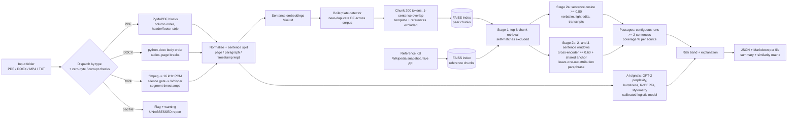
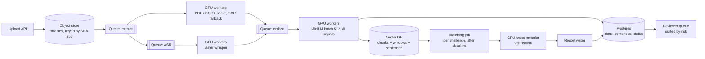

# Multimodal Submission Integrity & Plagiarism Detection Engine

A Python pipeline that ingests PDF, DOCX and MP4 submissions and does four things:

- extracts and normalises their text, including video transcripts with timestamps;
- indexes the text as dense vectors;
- scores each submission on three independent signals: internal peer similarity, external/web similarity and AI-generation likelihood;
- writes an audit report per file (JSON + Markdown) that quotes the exact overlapping passages with page numbers or video timestamps, so a reviewer can verify every claim in seconds.

```bash
python run_integrity_check.py --input_dir ./sample_submissions --output_dir ./reports
```

**Results on the bundled ground-truth corpus** (details and caveats in [EVALUATION.md](EVALUATION.md)):

| Check | Result |
|---|---|
| Files processed without crashing (incl. zero-byte PDF, corrupt DOCX, video with no audio) | 15 / 15, 3 correctly flagged |
| Peer + cross-modal pair detection (66 pairs) | 3 TP, 0 FP, 0 FN |
| Sentence-level evidence (is each flagged sentence really copied?) | P 1.00, R 0.93, F1 0.97 |
| Paraphrase pair (Jaccard 0.23) | detected; a 5-gram lexical baseline misses it |
| Out-of-sample: public MRPC paraphrase test (1,725 pairs), fixed thresholds | F1 0.81, precision 0.79 (tuned lexical/cosine baselines: precision 0.70–0.72) |
| Cross-modal: MP4 read-out of a PDF paragraph | matched to PDF **page 2**, video **00:00:04-00:00:24** |
| Shared 150-word case prompt across 5 files | 0 / 8 template-only pairs flagged (8 / 8 without the filter) |
| External (Wikipedia) copy | detected, source URL cited |
| AI-generated docs (2) vs human (8) | AUROC 1.0 here; **0.91 CV AUROC on public HC3 + SAGE data**, with caveats |
| Full run, 15 files, CPU only (Apple M5) | ~33 s warm (models cached) |
| Clean install from `requirements.txt` | verified on Python **3.9.25** and **3.12.15**: all tests pass, identical results |

---

## Contents

1. [Setup](#1-setup)
2. [Usage](#2-usage)
3. [Repository layout](#3-repository-layout)
4. [Architecture](#4-architecture)
5. [Methodology](#5-methodology): ingestion, indexing, matching, boilerplate, external, AI, explainability
6. [Output format](#6-output-format)
7. [Sample dataset](#7-sample-dataset)
8. [Scaling to 10,000 submissions](#8-scaling-to-10000-submissions)
9. [Assumptions](#9-assumptions)
10. [Limitations](#10-limitations)
11. [AI-assistant usage disclosure](#11-ai-assistant-usage-disclosure)
12. [Data sources and licences](#12-data-sources-and-licences)

---

## 1. Setup

Requires Python 3.9+. Clean installs were verified on Python 3.9.25 and 3.12.15 (macOS arm64, CPU only): all 17 tests pass and the outputs are identical. CI runs on both versions (`.github/workflows/ci.yml`). No system packages are needed: `imageio-ffmpeg` ships a static ffmpeg binary.

```bash
python -m venv .venv && source .venv/bin/activate
pip install -r requirements.txt            # or: pip install -r requirements-lock.txt (exact tested versions)
python scripts/download_models.py          # optional: pre-fetch all models (~1.6 GB) for offline runs
```

Models used, all open source and CPU-friendly:

| Purpose | Model | Size |
|---|---|---|
| Chunk / sentence embeddings | `sentence-transformers/all-MiniLM-L6-v2` | 90 MB |
| Paraphrase verification (re-ranker) | `cross-encoder/stsb-distilroberta-base` | 330 MB |
| Speech-to-text | Whisper `base.en` | 140 MB |
| Perplexity / burstiness | `gpt2` (124M) | 550 MB |
| AI classifier signal | `openai-community/roberta-base-openai-detector` | 500 MB |

## 2. Usage

```bash
# the root command: process a folder, write one JSON + one Markdown report per file, plus a summary
python run_integrity_check.py --input_dir ./sample_submissions --output_dir ./reports

# useful options
python run_integrity_check.py --input_dir DIR --output_dir OUT \
    --template_dir prompts/          # organiser's prompt text(s): always treated as boilerplate
    --online                         # also search the free Wikipedia API (falls back to local KB)
    --config config/default.yaml     # all thresholds, documented
    --set matching.sentence_threshold=0.85
    --no_ai                          # skip AI-likelihood estimation

make test        # 17 unit + end-to-end edge-case tests
make evaluate    # metrics vs ground truth, baselines, ablations, threshold sweeps -> evaluation/
make dataset     # regenerate the synthetic corpus (macOS `say` or espeak-ng for speech)
make calibrate   # refit the AI-likelihood combiner on HC3 + SAGE
make benchmark   # out-of-sample paraphrase benchmark on public MRPC + PAWS
```

Outputs in `--output_dir`:

- `<file>.json`: the structured report (schema below)
- `<file>.md`: the human-readable audit report
- `summary.md` / `summary.json`: batch table sorted by risk, the list of flagged files and the N×N peer-similarity matrix
- `similarity_matrix.csv`, `pipeline.log`

Sample outputs are committed in [`reports/`](reports/summary.md).

## 3. Repository layout

```
run_integrity_check.py        CLI entry point
evaluate.py                   evaluation harness (metrics, baselines, ablations)
integrity_engine/
  ingestion/                  pdf.py, docx.py, media.py (ffmpeg + Whisper), dispatch & error handling
  normalize.py                cleaning, header/footer detection, sentence splitting
  chunking.py                 sentence-aligned 200-token chunks with overlap
  embeddings.py               Sentence-Transformers wrapper (L2-normalised vectors)
  index.py                    FAISS IndexFlatIP / HNSW wrapper (NumPy fallback)
  boilerplate.py              document-frequency template detection
  anchors.py                  rare-number / named-entity "anchors" for paraphrase confirmation
  verification.py             cross-encoder re-ranking of candidate windows
  similarity.py               two-stage matching, passage building, coverage %
  reference_kb.py             local Wikipedia KB + optional live Wikipedia search
  ai_detection.py             perplexity, burstiness, classifier, stylometry -> calibrated logistic model
  scoring.py                  risk bands + plain-language explanation
  reporting.py                JSON / Markdown / summary writers
  pipeline.py                 orchestration
config/default.yaml           every threshold, documented
config/ai_calibration.json    fitted AI-combiner weights + CV metrics
reference_corpus/             Wikipedia snapshot used as the "web" (CC BY-SA 4.0)
sample_submissions/           15-file evaluation corpus + dataset_manifest.json (ground truth)
scripts/                      dataset builder, KB fetcher, calibration, model + public benchmarks, model download
.github/workflows/ci.yml      lint + unit tests (Python 3.9, 3.12) and an end-to-end job
tests/                        unit tests + hidden-edge-case end-to-end tests
reports/                      reports produced by the root command on the sample corpus
evaluation/                   results.md / results.json (evaluate.py), public_paraphrase.md (MRPC/PAWS)
```

## 4. Architecture



## 5. Methodology

### 5.1 Ingestion and normalisation (Task 1)

| Format | Extraction | Provenance kept |
|---|---|---|
| **PDF** | PyMuPDF text *blocks* (paragraph-level). Blocks are re-ordered for multi-column layouts: full-width blocks split the page into bands, and within a band the left column is read before the right. | page, paragraph |
| **DOCX** | `python-docx` walks the body XML in order, so paragraphs and table rows (merged cells de-duplicated) keep their sequence. Section headers/footers live in separate XML parts and are excluded automatically. | paragraph, page (explicit or rendered page breaks; otherwise estimated at 450 words/page and marked `page_is_estimated`) |
| **MP4 / audio** | ffmpeg (bundled) probes streams, then decodes the first audio track to 16 kHz mono PCM in memory. An RMS silence gate runs first, then Whisper `base.en` (greedy, `condition_on_previous_text=False`). Segments with `no_speech_prob > 0.6` or compression ratio > 2.4 are dropped, because these are Whisper's typical hallucinations on silence or noise. Sentences may span ASR segments; each sentence gets the start of its first segment and the end of its last. | start/end timestamps |
| **TXT / MD** | Paragraphs split on blank lines. | paragraph |

**Cleaning.** NFKC normalisation, ligature and smart-quote repair, de-hyphenation of wrapped words, and whitespace collapse.

**Header/footer stripping.** A block in the top or bottom 8% of a page is removed if its digit-normalised text ("Page 3" → "page #") repeats on at least half the pages. Bare page numbers ("3", "Page 3 of 10", "- 3 -") are removed anywhere.

**Reference lists.** Sections after a "References / Bibliography / Works cited" heading are kept in the report but excluded from scoring, because shared citations are not plagiarism.

**Sentence splitting** is rule-based. It is abbreviation-aware ("e.g.", "Dr.", "U.S.") and safe around decimals ("4.2%").

**Chunking.** Chunks are built from whole sentences up to **200 MiniLM word-piece tokens**, with a **one-sentence overlap** between chunks. This sits in the brief's 200–400-token band, chosen at the low end because MiniLM truncates at 256 tokens: a 400-token chunk would silently lose its tail. Short tails are merged into the previous chunk. Because chunks are sentence-aligned, every chunk maps back to exact sentence ids, and through them to pages or timestamps.

**Failure handling.** Every file goes through a guarded extractor. A zero-byte file, corrupt ZIP/PDF, password-protected PDF, image-only PDF (no text layer), video with no audio track, silent audio, unintelligible speech or unsupported type produces a `flagged`/`skipped` status. The file still gets its own report (risk `UNASSESSED`) with the reason, a warning in `pipeline.log` and a listing in `summary.md`. The batch always completes. `tests/test_edge_cases.py` exercises these cases end to end.

### 5.2 Indexing and peer similarity (Task 2)

- **Embeddings.** `all-MiniLM-L6-v2`, L2-normalised, so the inner product equals cosine similarity.
- **Index.** FAISS `IndexFlatIP`: exact brute-force cosine search, the right choice up to ~1M vectors. `matching.index_type: hnsw` switches to approximate search (see §8).
- **Self-match exclusion.** Each query chunk retrieves `top_k + (#chunks in its own document)` neighbours, and every neighbour from the same `doc_id` is discarded. Identical files with different names still match each other at 100%, which is tested.

**Two-stage matching.**

1. **Retrieve (recall).** Chunk-level nearest neighbours with cosine ≥ 0.55. This is deliberately loose.
2. **Verify and explain (precision).** Inside each candidate chunk pair, two paths run:
   - **Direct path.** Sentence pairs with bi-encoder cosine ≥ 0.80. This catches verbatim copies, light edits and transcripts of read-out text.
   - **Verified path.** Windows of 2 and 3 consecutive sentences are shortlisted by cosine ≥ 0.60, then confirmed by a **cross-encoder** (STS score ≥ 0.60). This catches paraphrase. A verified window must also share an **anchor** (a rare number or proper noun) unless the cross-encoder is ≥ 0.80 confident.
   - **Leave-one-out attribution.** Within a verified window, each sentence is re-scored with the window minus that sentence. If dropping a sentence *raises* the score, it was a bystander (an original sentence next to a copied block) and is not attributed. Mixing 2- and 3-sentence windows recovers paraphrased sentences at paragraph edges. Together these two v2 changes raised sentence-level F1 from 0.89 to 0.97 (EVALUATION.md §5.1).

   **Why the cross-encoder.** A benchmark (`scripts/benchmark_models.py`, EVALUATION.md §6) showed that *no* bi-encoder separates heavy paraphrase from unrelated answers to the same case. MiniLM scores real paraphrases as low as 0.66, while unrelated paragraphs about the same case reach 0.85. The cross-encoder reads both texts jointly and opens a +0.12 margin.

   **Why anchors.** Two LLM answers to the same prompt read as near-paraphrases (cross-encoder ≈ 0.70) without sharing any specific detail. A student paraphrasing a peer keeps the facts: "300 scooters" → "three hundred e-scooters", "1.2 lakh" → "120,000", "Vijay Nagar". Numbers are normalised across digits and words, including lakh/crore/million. An anchor must occur in at most max(2, 10% of documents).
3. **Passages.** Aligned query sentences are grouped into contiguous runs (gaps of one sentence are tolerated). A run needs **≥ 2 sentences**, or a single near-exact sentence of ≥ 12 words at cosine ≥ 0.90. One similar sentence between two answers to the same case is weak evidence.

**Peer similarity % = words in the query's scoring sentences that are covered by accepted passages ÷ all scoring words**, where scoring sentences exclude template and reference-list text. This is computed per source document (the N×N matrix) and as a union across all sources (the headline number). The metric is directional: a short video can be 81% covered by a long PDF while that PDF is only 18% covered by the video.

### 5.3 Boilerplate and template handling (Scenario 4)

Every sentence of ≥ 6 words is compared against all other documents' sentences (FAISS, cosine ≥ 0.92 means a near-duplicate). Its **document frequency (DF)** is the number of distinct documents containing it.

- Copying between two students gives DF = 2.
- A case prompt or instruction block pasted by every team gives a DF close to N.
- Sentences with **DF ≥ max(3, ⌈0.25·N⌉)** are boilerplate.

Boilerplate is excluded from chunks and from every score, and listed in the report under "Shared template text (excluded from scores)" with the count of documents that share it. If organisers supply the prompt (`--template_dir`), matching sentences are boilerplate regardless of DF. That is the most reliable option in production.

### 5.4 External / web similarity (Task 3)

- **Local "web".** `reference_corpus/wikipedia_snapshot.json` holds 11 public Wikipedia articles relevant to the case (micromobility, scooter sharing, battery swapping, CAC/CLV, Porter, SWOT, …). It is fetched by `scripts/fetch_reference_kb.py` through the MediaWiki API and committed for reproducible offline runs. Reference documents are chunked and indexed like submissions, matched with the same two-stage logic, and cited with their URL and paragraph number.
- **Live search (`--online`).** Each submission's three longest sentences are sent as queries to the free Wikipedia search API. The top hits are fetched, cached on disk and added to the reference index. Any network error logs a warning and falls back to the local KB. Commercial plagiarism APIs are out of scope by design.

### 5.5 AI-generation likelihood (Task 3)

The engine computes four transparent signals on the document's scoring sentences (≥ 6 words each):

| Signal | Intuition |
|---|---|
| GPT-2 log-perplexity (sliding 1024-token window) | LLM text is "predictable" to a language model |
| Burstiness (std of per-sentence log-perplexity) | humans alternate plain and surprising sentences |
| `roberta-base-openai-detector` probability | an open supervised detector |
| Assistant-phrase rate per 100 words ("delve", "in today's rapidly evolving landscape", "furthermore", …) | stylometric habits of chat assistants |

**Combination.** A standardised **logistic regression fitted on external public data, never on our evaluation set**: HC3 (human vs ChatGPT 2022) plus SAGE (human essays and articles vs GPT-4.1 / Claude 3.7 / Gemini 2.5), 577 samples, 5-fold **CV AUROC 0.91**. Features are clipped to ±3σ of the calibration data so the model cannot extrapolate to 100%. Each report lists the per-signal log-odds contributions.

**What calibration revealed** (`config/ai_calibration.json`, EVALUATION.md §4):

- On modern LLM text, perplexity alone is weak (AUROC 0.62) and the RoBERTa detector is at chance (0.55).
- A model trained only on 2022 ChatGPT data scores **0.57** on modern models.

The AI score is therefore labelled *advisory*. On its own it can raise a submission to MEDIUM risk but never to HIGH. Texts under 120 words (e.g. short video pitches) get "not estimated" with a reason instead of a noisy number.

### 5.6 Risk bands

| Band | Rule |
|---|---|
| HIGH | peer ≥ 30% **or** external ≥ 30% **or** (AI ≥ 80% **and** any overlap ≥ 10%) |
| MEDIUM | peer ≥ 10% **or** external ≥ 10% **or** AI ≥ 60% |
| LOW | otherwise |
| UNASSESSED | file could not be processed (reason given) |

### 5.7 Explainability (Task 4)

Each match in a report carries:

- the offending passage and the source passage, verbatim;
- in the Markdown report, runs of ≥ 3 shared words in **bold**, so a reviewer sees at a glance whether the match is verbatim or paraphrased;
- page / paragraph / timestamp / URL locations on both sides;
- the chunk cosine, the sentence-level evidence score and its method (cosine or cross-encoder), word-overlap Jaccard and a match-type label (`verbatim`, `near-verbatim`, `paraphrase`);
- a collapsible sentence-by-sentence alignment table.

The report opens with a single "Summary for reviewers" paragraph, such as:

> 81.2% … overlaps with sub_01_aarav.pdf. Strongest evidence: 00:00:04 - 00:00:24 <-> sub_01_aarav.pdf p.2 (verbatim, cos 0.82).

That paragraph is designed to be checked in under 30 seconds. Every report also records the thresholds used.

## 6. Output format

Each report follows the brief's schema (`document_id`, `total_integrity_risk`, `scores`, `peer_matches`, `multimodal_matches`, `explanations`). It adds `external_matches`, `boilerplate_overlaps`, `ai_analysis`, `score_details`, `warnings` and `metadata`. Abridged from [`reports/pitch_10_sanjay.mp4.json`](reports/pitch_10_sanjay.mp4.json):

```json
{
  "document_id": "pitch_10_sanjay.mp4",
  "total_integrity_risk": "HIGH",
  "scores": {"peer_similarity_percentage": 81.2, "external_similarity_percentage": 0.0, "ai_generated_probability": null},
  "peer_matches": [],
  "multimodal_matches": [{
      "matched_file": "sub_01_aarav.pdf",
      "similarity_score": 0.82,
      "sentence_similarity": 0.95,
      "evidence": "sentence cosine + cross-encoder verified paraphrase",
      "lexical_overlap_jaccard": 0.76,
      "match_type": "verbatim",
      "query_passage": "Our recommendation is to stay in Pune for the next 18 months and build a dense battery swapping network ...",
      "matched_passage": "Our recommendation is to stay in Pune for the next eighteen months and build a dense battery-swapping network ...",
      "location": {"query_timestamp": "00:00:04 - 00:00:24", "matched_page": 2, "matched_paragraph": 8},
      "sentence_alignment": [{"query_sentence": "...", "matched_sentence": "...", "score": 0.99, "method": "direct"}]
  }],
  "external_matches": [],
  "boilerplate_overlaps": [],
  "ai_analysis": {"probability": null, "reason": "Insufficient original text for a reliable estimate (94 < 120 words)"},
  "explanations": "81.2% of the original text overlaps with other submissions: sub_01_aarav.pdf (81.2%). Strongest evidence: ...",
  "warnings": [],
  "metadata": {"duration_seconds": 28.13, "asr_model": "whisper-base.en", "audio_rms": 0.10404}
}
```

`peer_matches` holds same-family matches (document↔document, video↔video); `multimodal_matches` holds video/audio↔document matches.

## 7. Sample dataset

`sample_submissions/` contains 15 files: 6 PDF, 6 DOCX and 3 MP4. They are all synthetic answers to a fictional case competition (VoltRide Mobility, an e-scooter start-up) and are generated by `scripts/build_dataset.py`. Every relationship is created by reusing the same text variable, so the ground truth in [`dataset_manifest.json`](sample_submissions/dataset_manifest.json) is exact down to sentence level.

| File | Ground truth |
|---|---|
| sub_01_aarav.pdf | original; the source of both the exact copy (sub_02) and the video read-out (pitch_10) |
| sub_02_meera.pdf | **exact copy** of two sub_01 risk paragraphs (page 2) |
| sub_03_kabir.docx / sub_04_diya.docx | **paraphrase pair**: same four arguments, synonyms + restructured sentences |
| pitch_10_sanjay.mp4 | **cross-modal**: Indian-English TTS reads sub_01's page-2 recommendation |
| sub_06_ananya.pdf | **external copy**: two paragraphs from Wikipedia "Scooter-sharing system" |
| sub_07_ishaan.docx, sub_15_tanvi.pdf | **AI-generated** (assistant-style prose) |
| sub_05_rohan.docx, sub_09_vikram.docx, pitch_11_leela.mp4 | **original, independent** (false-positive tests; same case, same cities) |
| sub_08_zara.pdf | original, **heavily formatted** (two columns, table, header/footer on each page) |
| silent_12.mp4, empty_13.pdf, corrupt_14.docx | **degraded**: no audio track / zero bytes / truncated ZIP |
| sub_01–sub_05 | all paste the same **150-word case prompt** + shared citations (Scenario 4) |

## 8. Scaling to 10,000 submissions

**Assumed workload per challenge:** 10,000 submissions, roughly 50% PDF, 30% DOCX and 20% video. Text averages ~2,000 words; videos average ~3 minutes.

Derived volumes:

- ~100 sentences, ~13 chunks and ~100 windows per document;
- ≈ **1M sentence vectors, 130k chunk vectors and 1M window vectors** (384-d);
- ≈ **6,000 minutes of audio**.

### 8.1 Processing topology



- **Stage DAG with idempotent tasks.** Each file moves through `extract → (asr) → embed → index → match → report` on a queue: SQS, RabbitMQ/Celery or Kafka. Tasks are keyed by the file's SHA-256, so retries are safe and byte-identical resubmissions are deduplicated for free. A file that keeps failing lands in a dead-letter queue, and its report says `UNASSESSED` (exactly as in the prototype).
- **Separate worker pools per resource.** PDF/DOCX parsing is CPU-bound and embarrassingly parallel. ASR, embedding, the cross-encoder and GPT-2 are GPU-bound and batched. Pools autoscale on queue depth, which also gives backpressure.
- **Two matching modes.**
  - *Incremental* (on upload): a new document queries the existing index for instant feedback.
  - *Final batch* (after the deadline): an all-vs-all pass. Boilerplate DF needs the full corpus, and coverage must be computed in both directions.

### 8.2 Compute choices (GPU vs CPU)

Throughput figures are order-of-magnitude estimates for a single NVIDIA T4. Measure before committing.

| Stage | Choice | Rough throughput | 10k-submission cost |
|---|---|---|---|
| PDF/DOCX parsing | CPU (PyMuPDF is ~ms/page) | ~50 docs/s per 8 vCPU | minutes |
| OCR fallback (scanned PDFs) | CPU Tesseract or GPU docTR | 1–3 s/page | the hidden cost if many scans; queue separately |
| ASR | **GPU, faster-whisper (CTranslate2, int8/fp16)**, `small.en` for accents | 50–100× real time per T4 | ~6,000 min audio → ~1–2 T4-hours |
| Embeddings (2.1M texts) | GPU, MiniLM fp16, batch 512 | ~5–10k sentences/s | ~5–10 min |
| AI signals (GPT-2 over ~16M tokens) | GPU | ~20–50k tokens/s | ~10 min |
| Cross-encoder verification | GPU, batched, cached | ~1–2k pairs/s | depends on the candidate count (see bottlenecks) |

At 10k submissions the entire GPU work fits in **~3–5 T4-hours**. On spot g4dn-class instances that is roughly single-digit dollars per challenge (check current cloud prices). CPU-only is feasible but ASR dominates at ~15–30 CPU-core-hours.

### 8.3 Vector database and index strategy

- **One challenge (~130k chunks + ~1M windows).** Flat (exact) FAISS is fine. 130k × 130k × 384 multiply-adds is ~6.5 TFLOP, seconds on a GPU and minutes on CPU. Flat gives perfect recall and needs no tuning, which is why the prototype uses it.
- **Cross-challenge archive.** Catching re-use from previous years or other universities means ~50 challenges/year × 130k = 6.5M chunks (plus 50M windows). Here **HNSW** (M = 32, efSearch ≈ 128, ~0.95–0.99 recall) gives millisecond queries.
  - Memory: 6.5M × 384 × 4 B ≈ 10 GB for raw vectors. **Scalar quantisation (int8)** cuts this ~4×, and **IVF-PQ** cuts it ~30× at a small recall cost. Exact re-scoring of the shortlist recovers precision.
  - Recall misses are tolerable in stage 1 only because stage 2 re-scores candidates exactly.
- **Engine.** Use **Qdrant** or **Milvus** (open source, HNSW plus quantisation, payload filters such as `challenge_id`, `year` and `modality`, horizontal sharding). `pgvector` is adequate below a few million vectors if Postgres is already the system of record. FAISS-GPU stays the tool for the batch all-vs-all pass.
- **Sharding** by challenge and year keeps per-query search small. A global HNSW over the archive serves cross-challenge look-ups.

### 8.4 Bottlenecks and how to handle them

1. **Cross-encoder candidates grow with topical homogeneity.** Every submission answers the same case, so many chunk pairs clear the loose 0.55 retrieval threshold. Mitigations:
   - cap `top_k`;
   - verify only windows whose bi-encoder cosine clears the prefilter;
   - skip windows already explained by the direct path;
   - cache scores per window pair;
   - distil the cross-encoder (MiniLM-L6 cross-encoders run ~3× faster);
   - apply leave-one-out attribution (≈ 2× the cross-encoder calls on this corpus: 799 vs 387) only at report time, to the passages actually shown.
2. **ASR** is the largest GPU consumer. Use faster-whisper with VAD trimming (skip silence), and batch by duration.
3. **Boilerplate DF** needs all sentences of the challenge. Over 1M sentences, use FAISS range search on GPU (one pass) or MinHash-LSH over normalised sentences, and require organisers to upload the prompt.
4. **AI-signal language models.** Keep GPT-2-small-class models, quantise them, or run them only on documents that need a second opinion.
5. **Report I/O.** 10k × 2 files is trivial, but serve reports from Postgres/S3 through the reviewer UI rather than the file system.

**Latency targets.**

- Incremental feedback: < 10 s for text, about real-time/30 for video.
- Final batch for a 10k challenge: under 1 hour after the deadline on 4 T4s, with ASR and embedding mostly done during the submission window.

### 8.5 Operations and quality at scale

- Version models, thresholds and calibration files, and write them into every report (the prototype already stores its thresholds).
- Recalibrate thresholds on a labelled sample of real adjudicated cases. Synthetic data cannot set production thresholds.
- Show reviewers a queue sorted by risk and by evidence strength, and record their decisions as labels for recalibration (active learning).
- Monitor the share of files flagged per stage, ASR no-speech rates and drift in the score distributions per challenge.

## 9. Assumptions

1. **Unit of evidence.** "Tokens" for chunking means the embedding model's word pieces. Chunks are 200 tokens: inside the 200–400 band and safely under MiniLM's 256-token limit.
2. **Peer similarity %** measures how much of *this* document's original text appears elsewhere. It does not say who copied whom, so both sides of a copy are flagged. Provenance (timestamps, drafts) settles direction.
3. **Template text.** Text shared by ≥ max(3, 25% of) submissions is treated as template. A ring of colluding students larger than that would be mistaken for template (see EVALUATION.md §7).
4. **Web search.** This is simulated with a committed Wikipedia snapshot (the brief allows this). A live Wikipedia search is available via `--online`.
5. **DOCX page numbers** are estimated when the file has no page-break markers, and the report says so.
6. **AI likelihood** is an advisory indicator. It is never sufficient alone for a HIGH rating and is not estimated for texts under 120 words.
7. **Language.** All models are English-only. Non-English text is still analysed, but the report carries a warning that its scores are unreliable; real support would need multilingual embeddings and ASR.
8. **Video.** Only the audio track is analysed. On-screen slide text would need OCR on keyframes (future work).

## 10. Limitations

See [EVALUATION.md](EVALUATION.md) §7 for measured failure cases. In short:

- The dataset is small and self-constructed, so the metrics are optimistic.
- The AI indicator relies heavily on assistant-style phrasing and is easily evaded by light editing.
- Sentence-level recall on the paraphrase pair is 0.80–0.92; heavily merged sentences are still missed.
- On adversarial word-order paraphrases (PAWS), the engine cannot tell "A to B" from "B to A"; it flags them as overlap.
- ASR mishears proper nouns.

**macOS note.** The PyPI wheels of torch and faiss each bundle `libomp`. `integrity_engine/index.py` loads torch first, sets `KMP_DUPLICATE_LIB_OK`, and runs FAISS single-threaded on macOS; without this the process segfaults when Whisper and FAISS run in the same process. The workaround is applied only on macOS.

## 11. AI-assistant usage disclosure

As the brief requires: an AI coding assistant (Claude, via Claude Code) was used throughout this project. It helped write the code and documentation, run the experiments, and draft the synthetic dataset texts (see `dataset_manifest.json`). All design decisions, thresholds and failure analyses are documented in this README and in EVALUATION.md, and I can explain each of them.

## 12. Data sources and licences

- **Wikipedia extracts** (`reference_corpus/`, and two passages in `sub_06`): CC BY-SA 4.0. Each record keeps its source URL.
- **HC3** (Hello-SimpleAI/HC3, CC BY-SA 4.0) and **SAGE** (EndLessTime/SAGE): downloaded to `.cache/` only for calibration. Neither is redistributed; only the fitted weights are committed.
- **Synthetic submissions.** Everything else in `sample_submissions/` is fictional. Speech was synthesised with macOS system voices (Aman, en-IN; Daniel, en-GB).
- **Models.** Each is used under its own licence: MiniLM (Apache-2.0), Whisper (MIT), GPT-2 (MIT), the RoBERTa detector (MIT) and the cross-encoder (Apache-2.0).
